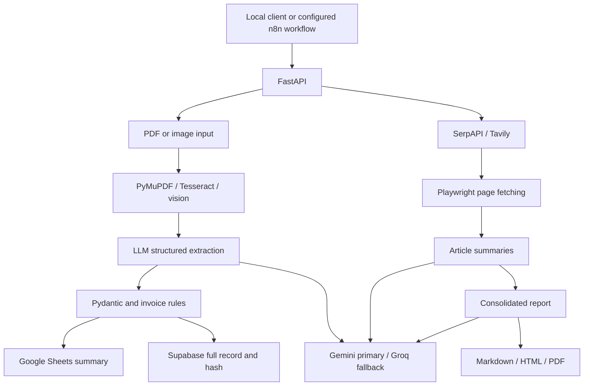

# AI Agents Hub

Python pipelines for structured invoice extraction and source-linked web research,
exposed through FastAPI and accompanied by n8n workflow templates.

The project reduces manual invoice data entry and repeated search/browse/summarize
work. It combines deterministic validation with LLM extraction and synthesis,
while keeping automation separate from the Python processing layer.

## Implemented capabilities

- **Invoices:** PDF text extraction, Tesseract OCR with Arabic/Persian digit normalization,
  image/scanned-PDF vision extraction, retries for incomplete fields, structured Pydantic
  output, required-field and arithmetic checks, SHA256 duplicate lookup through Supabase.
- **Storage:** Google Sheets summary rows and Supabase records containing line items.
  Storage failures are logged without discarding the extraction response.
- **Research:** SerpAPI search with Tavily fallback, concurrent Chromium page fetching,
  blocked/short-page filtering, concurrent summaries and a consolidated report.
- **Exports:** Markdown, escaped standalone HTML and PDF via WeasyPrint; Arabic/English
  response routing and direction-aware PDF layout.
- **Automation templates:** Google Drive invoice trigger and form-based research,
  with HTTP calls, Gmail notifications and Drive report upload.

These are task-oriented pipeline modules, not autonomous planning agents. No accuracy,
throughput or production-readiness benchmarks are claimed.

## Architecture



The extraction agent retries missing critical fields and retains the best result.
The validation agent performs deterministic checks. Search and browser agents acquire
source material; the summarizer generates article summaries and a final synthesis.
The shared LLM layer handles Gemini requests, retry/backoff and optional Groq fallback.
There is no arbitrary code-execution tool, SQL-generation agent or implemented
OpenAI/Anthropic provider routing.

## Stack and structure

Python, FastAPI/Uvicorn, Pydantic, PyMuPDF, Tesseract/Pillow, Google Generative AI SDK,
Groq, SerpAPI, Tavily, Playwright, WeasyPrint/markdown2, Google APIs, Supabase and n8n.

```text
api.py                    HTTP entry point
shared/                   Configuration, LLM, OCR, logging, language and URL safety
invoice_extraction/       Extraction, validation and storage modules
web_research/             Search, browser, summarization and report export
n8n/workflows/            Two sanitized, inactive workflow exports
database/                Supabase SQL schema
tests/                   Synthetic and mocked regression tests
requirements.txt          Direct dependency bounds
requirements.lock.txt     Resolved dependency pins for Python 3.12 / Linux
AUDIT.md                  Original-project audit
SECURITY.md               Security boundaries and publication findings
VALIDATION.md             Executed checks and explicit untested integrations
```

## Installation

CPython **3.12 on Ubuntu/Linux** is the verified environment. Other versions/platforms
have not been tested. System OCR and PDF-rendering libraries are required:

```bash
sudo apt install python3-venv tesseract-ocr tesseract-ocr-ara tesseract-ocr-eng libpango-1.0-0 libpangoft2-1.0-0 fonts-noto-core fonts-noto-extra
python3 -m venv .venv
source .venv/bin/activate
python -m pip install -r requirements.lock.txt
python -m playwright install chromium
cp .env.example .env
```

If Chromium reports missing system libraries, follow Playwright's installation
instructions for your OS. Do not modify system Python. `requirements.txt` supports
intentional dependency re-resolution; the lock file records the validated versions.
Pins do not include wheel hashes and do not guarantee identical external services.

## Configuration

Fill `.env` locally. Never commit it or service-account JSON.

| Variables | Purpose |
| --- | --- |
| `GEMINI_API_KEY` | Primary LLM API credential; not required for mocked tests or health check |
| `GEMINI_MODEL`, `GEMINI_EXTRACTION_MODEL`, `GEMINI_SUMMARIZATION_MODEL`, `GEMINI_VISION_MODEL` | Available Gemini models for each task |
| `GROQ_API_KEY` and `GROQ_*MODEL` | Optional fallback; vision needs an image-capable model |
| `SERPAPI_KEY`, `TAVILY_API_KEY` | Search primary/fallback; configure at least one for research |
| `GOOGLE_DRIVE_CREDENTIALS_JSON` | Service-account file path, relative to project root or absolute |
| `GOOGLE_SHEET_ID` | Destination spreadsheet; share it with the service account |
| `SUPABASE_URL`, `SUPABASE_KEY` | Backend Supabase URL/service-role credential |
| `TESSERACT_LANG` | OCR languages, default `ara+eng` |
| `LOG_LEVEL`, `LOG_DIR` | Private server log configuration |
| `N8N_WEBHOOK_URL` | Optional n8n URL for Compose |

Model placeholders must be replaced with provider-supported IDs. No paid model
availability check was performed. The implemented LLM strategy is Gemini first,
Groq fallback; legacy DEFAULT_LLM_PROVIDER settings do not select a provider.

For Supabase, apply `database/supabase_schema.sql` in your project's SQL editor.
The schema enables RLS and revokes anonymous/authenticated access; server-side
service-role access is privileged. Missing Supabase configuration disables duplicate
lookup and persistence. Sheets uses Sheet1 columns A:T and repairs the header row;
use a dedicated spreadsheet. Missing Sheets configuration yields sheets_synced=false.

## Run

```bash
source .venv/bin/activate
uvicorn api:app --host 127.0.0.1 --port 8000
curl http://127.0.0.1:8000/health
```

Interactive API documentation: `http://127.0.0.1:8000/docs`.
There are no run_invoice_pipeline.py or run_research_pipeline.py CLI scripts.

| Method | Endpoint | Input / result |
| --- | --- | --- |
| GET | `/health` | Process health only; does not verify external services |
| POST | `/invoices/process` | Multipart `file`, optional `drive_file_id`; validation/duplicate/Sheets status |
| POST | `/research/run` | JSON `query`, `max_results` (1–10), `export_format`, optional `response_language` |
| GET | `/research/report?path=...` | Downloads a file confined to reports/; accepts returned path or basename |

```bash
curl -F 'file=@/path/to/synthetic-invoice.pdf' http://127.0.0.1:8000/invoices/process
curl -H 'Content-Type: application/json' \
  -d '{"query":"Document extraction methods","max_results":3,"export_format":["markdown","html"],"response_language":"en"}' \
  http://127.0.0.1:8000/research/run
```

These processing calls contact external providers and may write to configured stores.
Mixed Arabic/English queries require explicit `response_language` (`ar` or `en`).
Uploads are limited to PDF/JPG/JPEG/PNG and 20 MiB; scanned PDFs are limited to 20 rendered pages.

Synthetic invoice example (illustrative structured output, not a live LLM result):

```json
{
  "vendor_name": "Example Supplies",
  "invoice_number": "INV-001",
  "invoice_date": "2026-01-01",
  "currency": "EGP",
  "subtotal": "100.00",
  "tax_amount": "14.00",
  "total_amount": "114.00",
  "line_items": [{"description":"Sample service","quantity":1,"unit_price":"100.00","line_total":"100.00"}]
}
```

`total_amount` includes tax minus discount. Missing currency defaults to EGP, which
is a project assumption requiring human review. API responses include an invoice ID,
validity/errors, duplicate status, Sheets synchronization status and extracted customer
email; they do not return the full structured invoice or a Supabase synchronization flag.

## Optional n8n

```bash
docker compose up -d
```

n8n is bound to `http://127.0.0.1:5678` and stores its state in a named Docker volume.
Read `n8n/workflows/README.md` before importing and activating either template.
Credential bindings, folder IDs and notification recipients must be configured.
Docker runs n8n only. The Python API must be reachable from Docker through a protected
host interface for workflow calls; the localhost startup above is for local clients.
No workflows were activated and no emails were sent during preparation.

## Testing

```bash
python -m pytest -q
python -m compileall -q api.py shared invoice_extraction web_research tests
python -m pip check
docker compose config --quiet
```

See `VALIDATION.md` for actual results. Tests use synthetic input and mocked external
services; no real keys, customer invoices or paid calls are needed.

## Limitations and future work

- Local prototype API: no authentication, per-user report isolation, rate limiting or job queue.
  Protect it before any deployment. Invoice processing blocks the asynchronous request path.
- Browser checks reject non-public destinations, but DNS rebinding and browser-network behavior
  require network-level egress isolation for a hardened deployment.
- Prompt instructions reduce injection risk but cannot prove LLM output correctness; human review
  remains necessary. Logs may contain document fields and provider errors.
- Duplicate checking fails open on missing/unavailable Supabase; concurrent requests can race.
  Sheets may already have a row when the Supabase unique constraint rejects a concurrent insert.
- Storage is best-effort, with no cross-service transaction or Supabase status in the API response.
- Gemini uses the deprecated `google-generativeai` SDK; migration to `google-genai` remains planned.
  See [Google's SDK documentation](https://ai.google.dev/gemini-api/docs/libraries).
- The Drive watcher module is an unimplemented placeholder. Use configured n8n Drive polling.
- n8n uses a floating latest image; pin a reviewed digest and validate workflows before deployment.
- Live OCR, browser, provider and automation integration checks remain unverified.

Future improvements: supported Gemini SDK migration, authenticated API/job execution,
explicit persistence status, transaction/retry design, stronger upload validation, deployment
network isolation, and consented synthetic end-to-end evaluation fixtures.

## License

No license is currently provided. Adding an open-source license requires the owner's decision.
